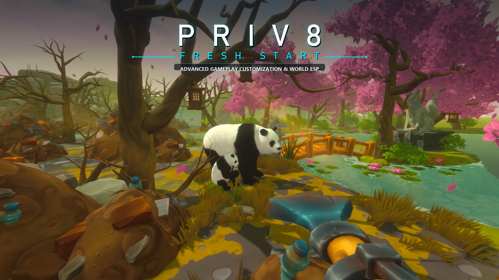
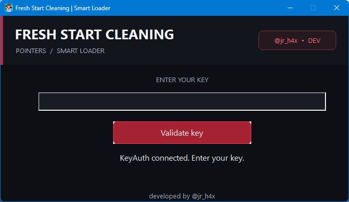
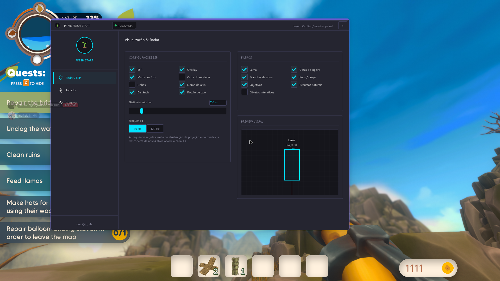
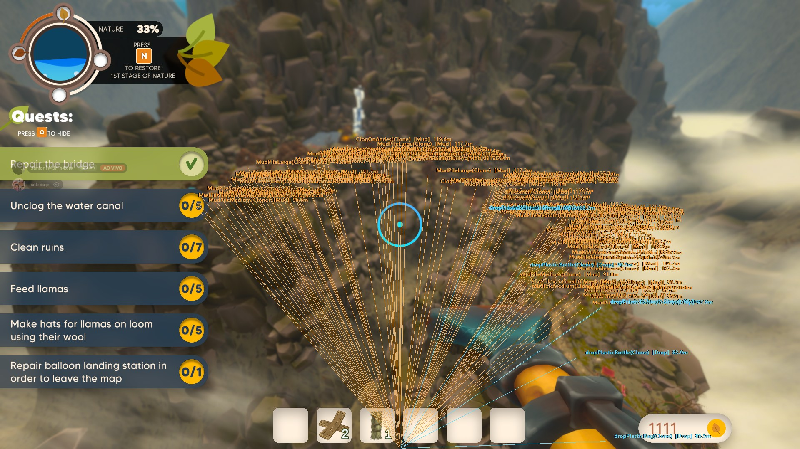

  

<h1 align="center">PRIV8 — Fresh Start</h1>

  <strong>Advanced Gameplay Customization & World ESP</strong>

PRIV8 is a dedicated tool for *Fresh Start Cleaning Simulator*, providing a standalone loader and an in-game DirectX 11 overlay control panel with comprehensive visual tracking, player physics manipulation, and quality-of-life utilities.

## Features

### World ESP & Radar
- **Mud & Dirt Tracking** — Highlights muddy areas, grime, and uncleaned surfaces across the map.
- **Trash & Drops ESP** — Displays discarded debris, recyclable items, and loose collectables.
- **Quest Objectives & Animals** — Marks active quest locations, objectives, and animals waiting for care or rescue.
- **Flora & Nature Tracker** — Pinpoints revitalized plants, garden areas, and environmental restoration points.
- **Machinery & Interactables** — Detects switches, water valves, power generators, and puzzle mechanisms.
- **Materials & Resources** — Locates valuable resources and crafting items in the environment.
- **Visual Overlays** — Customizable 2D bounding boxes, snaplines, directional markers, and live distance meters.
- **Customizable Range & Performance** — Adjustable scan radius (25m to 2000m) with 60 Hz / 120 Hz scan rates.

### Movement & Player Physics
- **Free Flight** — Fly freely across the map to access elevated and out-of-reach locations.
- **Ghost NoClip** — Move smoothly through obstacles, fences, and terrain collisions.
- **Speed Multiplier** — Boost base walk and exploration speed from 1.0x up to 8.0x.
- **Sprint Multiplier** — Accelerate sprint speed up to 8.0x for rapid map traversal.
- **Jump Height Multiplier** — Fine-tune jump power up to 5.0x for higher leaps.
- **Gravity Control** — Adjust world gravity multiplier from 0.0x (zero gravity) to 3.0x.

### Teleportation
- **Teleport to Aim** — Instant raycast teleportation directly to the location you are looking at.
- **Custom Keybind** — Configure a dedicated hotkey to trigger instant teleportation while in-game.

### Engine Runtime & Diagnostics
- **Live Memory Inspector** — Real-time display of Unity/Il2Cpp engine status, PID, and target entity count.
- **Coordinate Monitor** — Live XYZ vector monitoring for both player position and active camera angles.
- **Snapshot Exporter** — Export captured world targets and runtime entity data directly into JSON format.

### Overlay & Hotkeys
- **Insert** — Toggle In-Game Control Panel visibility.
- **DirectX 11 ImGui Interface** — Clean, responsive dark-themed dashboard.

## Screenshots

### Loader

### In-Game Control Panel

### In-Game ESP & Gameplay

## Access & Authentication

A valid authentication key is required to access PRIV8.

Free access keys are available at:

**https://phsldev.eu.org/**

## Compatibility

Designed for **Fresh Start Cleaning Simulator** on Steam (64-bit Windows / Unity Il2Cpp).

## Developer

**jrh4x** &nbsp;

## Download

  <a href="https://github.com/jrh4x/priv8-fresh-start-cleaning-loader/raw/refs/heads/main/Priv8%20-%20Fresh%20Start.exe">
    <strong>DOWNLOAD PRIV8</strong>
  </a>

---

*PRIV8 is an independent community project. It is not affiliated with, endorsed by, or sponsored by Awaken Realms, Merge Games, or Valve Corporation.*
